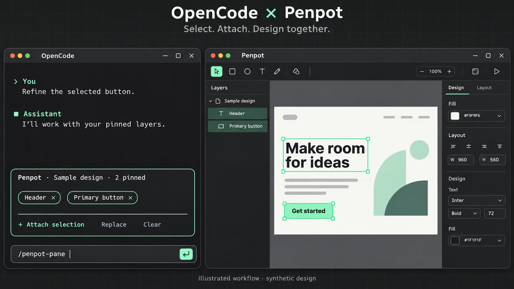

# OpenCode Penpot Selection

**Select layers in Penpot. Pin them in OpenCode. Keep designing.**



*AI-generated workflow illustration using a fictional design—not a product screenshot.*

Stop explaining which “button” or “header” you mean. This plugin puts your selected
Penpot layers in a small pane above OpenCode's chat input, so your next message
includes the exact layer references.

**Experimental · OpenCode V2 terminal only · Tested with OpenCode 2.1.3.**
Not an official OpenCode or Penpot product. Newer host versions need verification.
Known upstream dependency vulnerabilities remain; read [Security](SECURITY.md).

## Before you start

- **OpenCode V2** in your terminal. Desktop, web, and Mini are not supported.
- **Penpot**, with a design open and its MCP integration connected to OpenCode.
- **Node.js 22.18+**, npm, and Git for installation.

MCP is the connection that lets OpenCode talk to Penpot. This plugin adds the
selection pane; it does **not** install or connect Penpot for you. Check `/mcps`
in OpenCode first. [Connection and setup help →](docs/SETUP.md)

## Install once, use in any project

Run these commands in a terminal:

```sh
git clone https://github.com/nurfaizfoat/opencode-penpot-selection.git
cd opencode-penpot-selection
npm ci --ignore-scripts
npm run check
npm run install:global
```

This adds the plugin to your personal OpenCode settings, with a backup first.
The default MCP server name is `penpot`; register that connection globally too.
Keep this folder and its dependencies: OpenCode loads the plugin from here.

Now open OpenCode **in your actual project**, such as your website folder. You
don't need to work inside this plugin's folder. Run `/reload` in an already-open
OpenCode window. The pane belongs to a session, not the welcome screen; send
your first message before attaching layers.

Already used `setup:local`? Keep only one registration. See
[setup options](docs/SETUP.md) for local-only installs and troubleshooting.

## Your first design conversation

1. **Open your design in Penpot.** Connect it through **File → MCP Server → Connect**
   if needed; menu wording may vary by version.
2. **Select a layer**, or several layers, on the canvas or in the Layers panel.
3. **In OpenCode, run `/penpot-pane`** or click **+ Attach selection**. Approve the
   permission request if one appears.
4. **Check the names in the pane**, then ask your question:

   > Review these layers for spacing and hierarchy. Suggest changes, but don't edit yet.

The references stay pinned for your next messages until you remove or clear them.
Selecting something else in Penpot does not silently change what you attached.

**Attaching layers does not call a model or edit your design.** Sending a normal
message does use your configured model. Attachments contain names and file/page/layer
IDs—not screenshots, layout measurements, or a full design export. The assistant
can inspect the referenced layers through the usual tools and permissions when asked.

## Pane controls

| You want to… | Use |
| --- | --- |
| Add your current selection | `/penpot-pane` or **+ Attach selection** |
| Replace all pinned layers | `/penpot-replace` or **Replace** |
| Remove one layer | Click its chip, or `/penpot-remove` |
| Remove everything | `/penpot-clear` or **Clear** |

`/penpot-pane` attaches the selection; it is not a show/hide toggle.
`/penpot-attach` also works. The default shortcut is **Ctrl+Alt+P**;
[disable or change it](docs/SETUP.md#shortcut) if you prefer slash commands.

Up to **50 layers** can be pinned. Reattaching the same layer updates its label
instead of adding a duplicate. Empty or failed captures keep your previous pins.

## Something not working?

- **No pane?** Enter a session, then `/reload`. Check that the plugin is registered
  globally or for the project you opened.
- **Can't attach?** Check `/mcps`, connect the open file in Penpot, select an actual
  canvas layer, and send an initial message in the OpenCode session.
- **Old or missing layer?** Pins remember IDs, not a live selection. Reattach renamed
  layers; deleted layers need a new selection.

[More setup help](docs/SETUP.md) · [Security and privacy](SECURITY.md) ·
[Test results and remaining checks](docs/TESTING.md)

## Privacy, in plain language

Pins are saved per session. Their names and IDs accompany subsequent messages and
may reach your model provider—even if Penpot runs locally. **Clear** stops future
attachments; it does not erase earlier chats, logs, backups, or provider records.

Local hosting reduces network exposure, but doesn't fix vulnerable software. Keep
Penpot updated and its web, MCP, and debugging ports private. Don't share MCP keys,
token-bearing URLs, or confidential layer names. [Read the security notes →](SECURITY.md)

## Updating or removing

From this plugin's folder, update with `git pull --ff-only`, then run
`npm ci --ignore-scripts` and `npm run check`. Reload OpenCode afterward.

To remove the global registration: `npm run uninstall:global`.
The plugin is not published to npm; don't use `npm install -g` for this project.

## Contributing

Run `npm run check`, `npm audit`, and `npm pack --dry-run` before proposing changes.
Tests use fictional data and make no model calls. Real-host checks are documented
separately in [TESTING.md](docs/TESTING.md).

Follow [AGENTS.md](AGENTS.md). Preserve permission checks, session isolation, safe
errors, and the no-model/no-design-edit attachment boundary. Never commit personal
configuration, credentials, or real design snapshots.

## License

[MIT](LICENSE).
